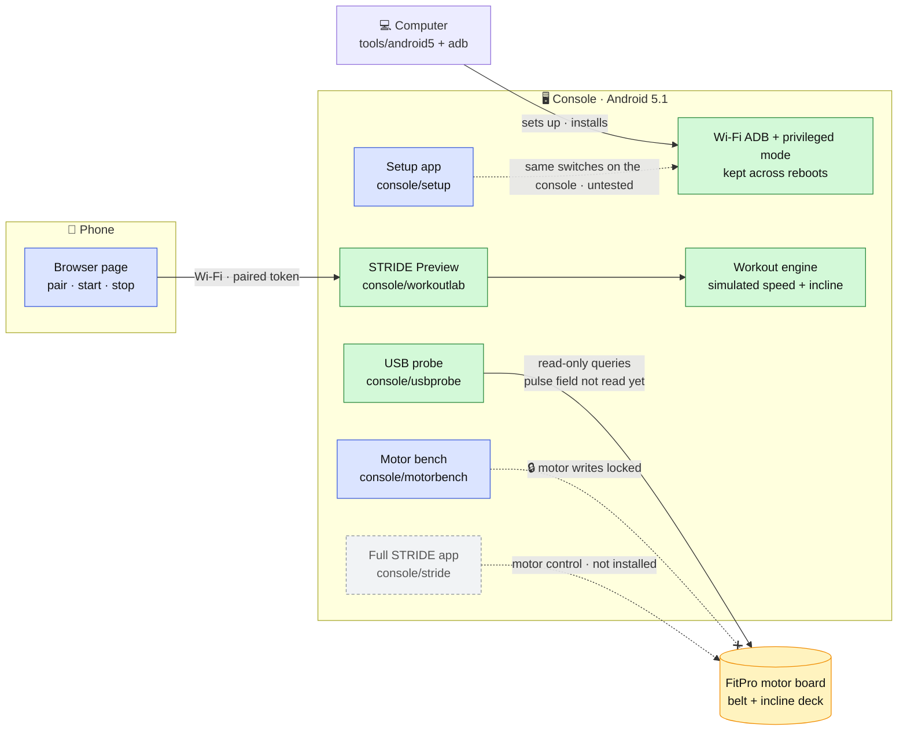

# STRIDE

This fork runs STRIDE on an older NordicTrack console (Android 5.1) and works toward walks that
adapt to your heart rate. Today you can reach and configure the console
without replacing iFit, run the workout screens in simulation, and read the motor board without
driving it.

> **Nothing in this fork moves the belt or deck yet.** Motor control is unproven on this console
> and there is no live heart-rate source yet, and the code keeps them disconnected until they are.

**Jump to:** [What's in this repo](#whats-in-this-repo) ·
[How it fits together](#how-it-fits-together) · [Next steps](#next-steps) ·
[Manual setup](#what-still-needs-to-be-done-manually) ·
[Upstream README](#upstream-project-documentation)

## What's in this repo

**Status key:** ✅ verified on the real hardware · 🧪 built and tested, not yet on the hardware ·
🔒 locked on purpose · 📦 inherited from upstream, not used on this console

| Part | What it does | Status |
|---|---|---|
| [`console/workoutlab`](console/workoutlab/README.md)<br>STRIDE Preview 0.2.1 | The console app. It has four guided routines plus a manual walk; a 400 m oval, incline profile and heart-rate chart; saved history; and a phone page over Wi-Fi. Speed and incline are simulated, and it has no motor code. | ✅ 0.2.0 runs on the console in simulation<br>🧪 0.2.1 built (36 tests), not installed yet |
| [`console/usbprobe`](console/usbprobe/README.md)<br>USB probe 0.2 | Asks the motor board what it is, its speed and incline limits, and its current status. It sends read-only queries. | ✅ identity, limits and status read on the console (17 tests)<br>The board also advertises a pulse field, which the probe doesn't read yet |
| [`console/motorbench`](console/motorbench/README.md)<br>Motor bench 0.1.0 | A manual motor controller wired to a simulated board, for developing motor logic with no treadmill involved. | 🔒 real motor writes are blocked in code<br>🧪 33 tests, run on an emulator |
| [`console/setup`](console/setup/README.md)<br>Setup app 0.1.1 | An on-console wizard: keep privileged mode after a reboot, turn Wi-Fi ADB on or off, an optional USB-debugging action, optional installers. | 🧪 built (17 tests), not yet tried on the console |
| [`tools/android5`](tools/android5/README.md) | Computer-side scripts that set up, check and undo console access over ADB. | ✅ the access steps survived a real power cycle<br>🧪 the scripts (20 tests) not rerun on a freshly reset console |
| [`console/stride`](CONTRIBUTING.md)<br>STRIDE 0.8.0 | The full upstream app: motor control, five screen designs, Bluetooth FTMS, Home Assistant. | 📦 builds for Android 5, not installed on this console |
| `homeassistant/` · `protocol/` · `tools/unchain.sh` | Upstream extras: Home Assistant scripts, the decoded FitPro protocol, and the iFit removal script. | 📦 kept for reference; `unchain.sh` is not used on this console |
| [`docs/`](docs/README.md) · [`CLAUDE.md`](CLAUDE.md) | The architecture and decision record, the Android 5 port log, coding standards, deploy and verify runbooks, and rules for coding agents. | |

**Tested on one machine:**

| | |
|---|---|
| Treadmill | NordicTrack Commercial 1750, console part 388129 |
| Console | Android 5.1.1 (API 22), 800×480 screen, WebView 83 |
| Motor board | FitPro1 over USB `213c:0002`, model 14116 |
| Phone | Pixel 10 XL, for the Preview's browser page |

## How it fits together



**Reading the diagram:** green means verified on the hardware, blue means built but not proven
there, and grey means inherited and not installed. Solid arrows work today. Dashed arrows are
unproven or not built yet, and ✕ marks a path that is locked off on purpose.

- **Kotlin owns the machine and HTML owns the screen.** The workout engine runs natively and the
  console and phone screens only send it validated actions. The engine itself runs in simulation:
  it has no connection to the board.
- **Heart rate has two separate channels.** Timestamped readings (`/api/hr`) may one day guide a
  workout. Display-only readings (`/api/hr-display`) never can, because their age is unknown. Both
  were built for the Sense 2 probe, which has been removed, so neither has a sender yet. The
  treadmill's own pulse input is the next candidate.
- **Each console app is its own package.** No live motor service connects the apps, so working on
  the screens, sensors or setup can't accidentally start the motor driver.

The full map, including trust boundaries and the decision record (D01–D16), is in
[docs/architecture.md](docs/architecture.md).

## Next steps

The heart-rate path and the motor path don't depend on each other, so they can move in parallel.
Anything that touches the treadmill needs someone standing at it.

| # | Next step | Why | Needs |
|---|---|---|---|
| 1 | Install Preview 0.2.1 on the console and check it on the real screen | The console still runs 0.2.0 | Console powered on |
| 2 | Try the setup app on the console one switch at a time, then re-check after a power cycle | Proves access can be set up without a computer doing it | You at the console |
| 3 | Find out whether this treadmill reports pulse: add the board's pulse field to the USB probe's read-only queries, then read it with hands on the grips (or a strap, if the console has a receiver) | The board advertises the field, but on upstream's C 1750 it read zero all walk because that machine has no grips | You at the treadmill |
| 4 | If it reports real values: measure how often they update, check that each reading is new, and design how they reach STRIDE Preview without adding USB code to it | Live heart rate is the input for adaptive walks, and every reading must carry its age | Step 3 shows real readings |
| 5 | With someone present and the safety key out: board reads from a cold start and exclusive USB ownership. Then real speed, incline, safety-key and stop behavior. Only then a separately reviewed build with bounded manual motor control | Nothing should drive the belt until its feedback and stops are proven | You at the treadmill |
| 6 | Only after 4 and 5: design how workouts drive the real motor, with limits, interlocks and a reviewed fail-safe | Heart-rate-driven motion stays disconnected until both sides are trustworthy | Steps 4 and 5 done |

The Sense 2 watch-face probe has been removed from this repo. Fitbit turned off the sign-in its
phone companion needed (seen 2026-11-02), so no reading could leave the watch. The watch stays on
your wrist as a display with Fitbit's own faces. Its [last version](https://github.com/jmonrove/strideApp/tree/6d812473637207cae7771d1654ed9d72f4794590/wearables/sense2) is in git
history; see decisions D15 and D16 in the [architecture doc](docs/architecture.md#decision-record).

## What still needs to be done manually

For someone starting with the stock console:

1. **Enter iFit privileged mode once** to reach Android and install the setup APK.
   The initial challenge/response step is not automated by this project.
2. **Join a trusted Wi-Fi network and install a trusted build of the setup APK.**
   Build instructions are in [console/setup](console/setup/README.md); this fork
   has not published a public binary release. Approve Android's
   installation/unknown-sources prompt if shown. The upstream motor-app release
   linked later in this README is a different application.
3. **Apply the setup actions yourself.** Setup APK 0.1.1 offers an experimental
   **Enable USB debugging** action, then **Keep privileged mode after reboot** and
   **Wi-Fi ADB debugging** switches. Each change needs explicit confirmation.
   The USB action uses a vendor hook with broader debug/console side effects; it
   has not been physically validated from this APK. If it fails, use Android
   Developer options; tap About tablet → Build number seven times if necessary,
   then enable USB debugging manually.
4. **Connect your computer:** install Android Platform Tools and run
   `adb connect TABLET_IP:5555`, replacing `TABLET_IP` with the console's current
   address. On the tablet, approve **Allow USB debugging?** and optionally select
   **Always allow from this computer**. The app cannot approve a computer for you.
5. **Approve optional Termux/STRIDE Preview installations.** If direct Wi-Fi setup
   is denied, the Termux fallback requires opening Termux, pasting the copied
   script, reviewing it, and pressing Enter.
6. **Power-cycle the treadmill yourself**, with no workout running and the safety
   key removed. Run verification and visually check that privileged mode survives
   without another response code. A marker/property readback alone does not prove
   a successful reboot or the visible privileged-mode state.

On the development treadmill, privileged mode and authenticated Wi-Fi ADB already
survived a power cycle using the original commands. The new setup APK still needs
its own physical test. Persistent privileged mode is distinct from permanent
Android root, which was not installed. These access steps do not validate motors
or establish a working Sense 2 → phone → treadmill stream.

## Where to read more

| If you want… | Read |
|---|---|
| Complete access instructions and undo steps | [tools/android5/README.md](tools/android5/README.md) |
| Setup app details | [console/setup/README.md](console/setup/README.md) |
| Architecture, decisions and the validation snapshot | [docs/architecture.md](docs/architecture.md) |
| The Android 5 port log: ADB, iFit and board-query findings | [docs/ANDROID_5_PORT.md](docs/ANDROID_5_PORT.md) |
| Rules for coding agents, and every other doc | [CLAUDE.md](CLAUDE.md) · [docs/README.md](docs/README.md) |
| Safety, before touching anything that moves the belt | [SAFETY.md](SAFETY.md) |

## Upstream project documentation

The material below is inherited from `keranm/strideApp`. Its first-person account,
hardware ranges, installation procedure and daily-use claims describe the upstream
author's system. They are not validation results for this fork's Android 5.1
console. Our current hardware/evidence record is [here](docs/ANDROID_5_PORT.md).

**Replace the iFit software on a NordicTrack treadmill. Keep the belt, lose the subscription.**

**Please note**: This is a hobby project by one person and Claude Code, please don't get upset at that. Claude Code is enabling me to be able to do something I've dreamed of doing for a few years but didn't have the ability. Now I'm able to walk/run on my own physical hardware that I bought without it having someone else's subscription software on it. If you don't like that 90% of this was coded with AI tools like Claude Code - then this isn't the project for you. If you want to fork this, put your fingerprints all over it ... please do, I'd welcome that!

> ### 🚧 Early days and factory reset has saved me more than once
>
> It works, and I walk on it most days, but it works on *my* machine. Nobody
> else has installed it yet and I've no idea how it behaves on other hardware.
>
> Nothing here is supported, so use it at your own risk. If it goes wrong a
> factory reset puts the original software back, and I've done that plenty of
> times while building this.
>
> Read the code, take the [protocol notes](protocol/FITPRO_PROTOCOL.md), and
> tell me what board your treadmill has.

> ⚠️ **This drives a motorised treadmill.** Read [SAFETY.md](SAFETY.md) before
> you install anything. Your physical safety key is still the stop that matters
> and it cuts the motor directly. STRIDE drives the incline, but speed is only
> ever suggested. You decide when to go faster.

> **Gen 7 / iFit 2.0.** Second-hand reports say this update closes the
> privileged-mode route everything here depends on. If you know how to do this on Gen 7
> let us know the steps and we can update this


I got tired of iFit on my NordicTrack. Manual mode, a 400 m loop, and an
interface that kept asking me to subscribe. The console turns out to be an
Android tablet talking to a separate motor board, so I replaced what runs on
the tablet and left the motor board alone.

The belt and the deck now work with no login, no subscription and no internet.
If you want it, everything the machine knows turns up in Home Assistant as
ordinary entities. I built it with Claude Code alongside me, and there's a
[full write-up of how the jailbreak works](https://theidea.works/blog/jailbreak-nordictrack-treadmill/)
if you'd rather read the story than the steps.

**[v0.8](https://github.com/keranm/strideApp/releases/latest)**, in daily use,
and it now pairs with Zwift over Bluetooth FTMS.


**[More screenshots →](docs/GALLERY.md)**

---

## What's in here

| | |
|---|---|
| **`console/`** | The Android app that replaces iFit on the treadmill's own screen. Talks to the motor board over USB, drives the incline, runs guided walks, and gives you five completely different interfaces to pick from. |
| **`homeassistant/`** | Optional scripts for the coach, the reminders and a health dashboard. The treadmill shows up in Home Assistant without any of them. |
| **`protocol/`** | The [FitPro serial protocol](protocol/FITPRO_PROTOCOL.md), decoded and written down. If you're working on a different machine, start here. |

There used to be an `ios/` folder. That's now its own thing,
**[AH for HA](https://github.com/keranm/ah-for-ha)**, which pushes Apple Health
into Home Assistant and has no treadmill in it at all. It grew to 39 metrics,
rings, sleep stages and workouts, and most people who want that will never own
a treadmill.

STRIDE kept the half it cares about. An outdoor walk can still become a
gradient profile the deck replays, because that arrives over MQTT and the
console has never cared who published it.

---

## Home Assistant needs nothing installed

Put your broker details into Settings → Home Assistant on the treadmill and a
**Treadmill** device shows up, with speed, incline, distance, elapsed, pulse,
calories, mode and workout, plus a device per person as they walk. The console
publishes its own MQTT discovery, so there's no integration, no YAML and no
custom component.

Build whatever dashboard you like from it. There's no STRIDE dashboard you have
to accept.

The `homeassistant/` scripts are for the extras: the coach, the reminders, and
an opinionated health dashboard if you want a starting point.

---

## Will it work on my treadmill?

Honestly, maybe. It's proven on one machine, mine:

| | |
|---|---|
| Model | NordicTrack C 1750 |
| Generation | Gen 6, the embedded "CLASSIC" console |
| Motor board | FitPro, device id `0x04` |
| Reported ranges | incline −3 to +12 %, speed 1.6 to 20 km/h |

Other Gen 6 NordicTrack and ProForm consoles on the same board are probably
fine, because the protocol looks like a family rather than a single model, but
nobody has tried. You also need a console you can reach with `adb`, and that's
the part that varies most by model and year.

[`console/usbprobe`](console/usbprobe) asks your board what it is and changes
nothing. It's an app you install on the console, so it needs ADB and the iFit
software out of the way first, which makes it step 6 below rather than
something you can run today.

**Please open an issue with whatever it tells you,** working or not. A list of
known-good boards would be the most useful thing this project could have and it
doesn't exist yet. I'm not buying more treadmills to build one.

---

## Installing

**[docs/INSTALL.md](docs/INSTALL.md)** has the full step by step, but read the
banner at the top of this page first. Nobody who didn't already know the
answers has followed that guide yet, and it marks its own weak spots.

In outline:

1. **Factory reset the console.** Stay offline afterwards.
2. **Enable privileged mode.** Tap ten times, wait seven seconds, tap ten more,
   then answer the challenge code the console gives you.
3. **Force stop iFit Admin** (`com.ifit.eru`) and take away its two
   permissions, then force stop and uninstall iFit (`com.ifit.standalone`).
4. **Enable ADB over Wi-Fi.** Tap Build number seven times, turn on USB
   debugging, join your network.
5. **Run [`tools/unchain.sh`](tools/unchain.sh).** Disables the iFit packages
   and installs the launcher.
6. **Identify your board** with [`console/usbprobe`](console/usbprobe), which
   reads and changes nothing. Report what it says.
7. **Install the console app**, then set it up on its own screen. Either grab
   the signed APK from [the latest release](https://github.com/keranm/strideApp/releases/latest)
   and `adb install -r` it, or build your own with `console/stride/run.sh`.
   Pick one and stay on it — they're signed with different keys, so swapping
   later means uninstalling and losing your settings.
8. **Optional:** enter broker details on the console to get the treadmill into
   Home Assistant, then add the coach.

Stop after step 7 and you've got a treadmill with no subscription. Steps 1 to 7
need nothing installed on the Home Assistant side.

If you'd rather not drive it by hand, point Claude Code at this repo, give
it the treadmill's IP address, and ask it to follow the install guide over ADB.
That's how most of my own installs have gone.

---

## Configuration

**The console configures itself.** Broker details, who walks, units, warm-up,
coach, heart rate, display: all of it lives in Settings on the treadmill's own
screen. No config files, no rebuild.

**The Home Assistant side reads one file:**

```sh
cp homeassistant/stride.conf.example homeassistant/stride.conf
```

Every key is documented in the example. Leave anything blank and that subject
is simply absent, so no scale, no blood-pressure cuff, no phone. The coach says
nothing about what it wasn't given rather than guessing at it.

`coach_ai_task` has no default, because which AI entity you have depends on
which integration you set up.

**For weekly and monthly totals**, copy
[`homeassistant/packages/stride.yaml`](homeassistant/packages/stride.yaml) into
your Home Assistant config. The console's distance counter resets every walk,
so the accumulating has to happen in HA. That file also creates the helpers the
coach and reminders need.

---

## How it's put together

A few decisions that will save you reading the code to find them.

- **Kotlin owns the treadmill, HTML owns the screen.** The five interfaces are
  HTML in a WebView, so you can design them in a browser. Tap SPEED+ and the
  belt speeds up, but the request goes through Kotlin first, which clamps it to
  whatever the board says it can do. A bad layout can't outrun the machine.
- **The coach decides when to speak, Home Assistant decides what it says.**
  With HA unreachable it still marks your kilometres, using a set of lines
  built into the console.
- **Never hand over a number without its age.** Health metrics that reset at
  midnight are withheld entirely if they haven't changed since midnight, rather
  than being passed on as today's. This one came from a real incident: the
  sensors hold yesterday's closing total and look exactly like today's running
  total, so the coach quoted yesterday's numbers back at me as though they were
  fresh.
- **Coaching and recording are per person, not per console.** Guests get
  neither. They're summarised at the end of a walk and then forgotten.

---

## Fork it

Please do. STRIDE is [Apache-2.0](LICENSE), so you can change it, ship it, sell
it and build something else out of it without asking me. There's no CLA and you
keep the copyright on whatever you write.

The thing I'd most like back is **what board your treadmill has**, working or
not. That list is one machine long today and it can only grow from other
people's treadmills. There's an
[issue template](https://github.com/keranm/strideApp/issues/new/choose) for it.

[CONTRIBUTING.md](CONTRIBUTING.md) covers getting set up, where things live,
how to redesign an interface in a browser without touching a treadmill, and the
rules I'd ask you to keep if you're changing anything that moves the belt.

---

## Thanks

**[nordictrack-ftms-bridge](https://github.com/ciarancoffey/nordictrack-ftms-bridge)**
by @[ciarancoffey](https://github.com/ciarancoffey). A couple of folks on reddit asked whether STRIDE could speak FTMS, which is the
standard Bluetooth service Zwift and friends use to talk to a treadmill, and
I took a look at Ciaran's project. This showed that YES an iFit Android console can be a Bluetooth LE *peripheral*, not just a
central. Using that as inspiration I coded up a working FTMS implementation

That project is AGPL-3.0 and STRIDE is Apache-2.0, so no code moves between
them. FTMS is a published Bluetooth SIG specification, and anything built here
gets built from the spec.

The install guide's [own credit](docs/INSTALL.md#credit) covers the community
Gen 6 modding guide that steps 1.1 to 1.4 follow.

---

## Licence

[Apache-2.0](LICENSE). No warranty, and see [SAFETY.md](SAFETY.md).

STRIDE is an independent project, built for compatibility with hardware its
authors own. Not affiliated with or endorsed by iFIT, ICON Health & Fitness,
NordicTrack, ProForm, Apple or Home Assistant. Trademarks belong to their
owners and are used here only to say what this works with.

This repository contains no code from any of those companies.
