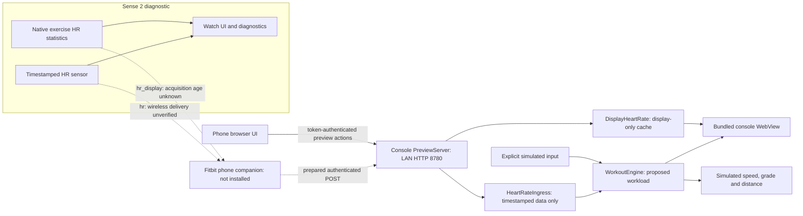
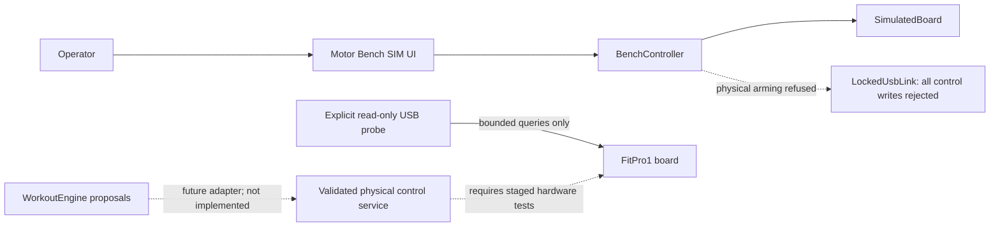

# STRIDE Android 5.1 fork: architecture and decisions

Snapshot: **2026-10-30**, branch `android-5-compat`. This document describes what
exists, its provenance, and the boundaries intentionally retained while validating
one older console. It is not an assertion that the full adaptive treadmill system
is operational. Module READMEs and tests contain detailed contracts; update this
snapshot when a component crosses a hardware-validation boundary.

## Goal and current outcome

The intended system runs three or four repeatable workouts on the treadmill,
shows the original STRIDE-style track/profile visualizations, obtains heart rate
from a Fitbit Sense 2 paired to an Android phone, and eventually modulates speed
and incline within explicit user/board limits. The development phone is a Pixel
10 XL. The current implementation uses heart rate only; it does not implement a
clinical assessment or a general feed of every watch vital.

Today the console preview, access tools, read-only board diagnostics and watch
probe exist independently. Physical motor control and the complete wireless
watch → phone → console path are **not validated**. Exercise-HR statistics can be
shown on the watch, but do not expose acquisition timestamps needed by the
current guidance contract.

## Provenance

| Source | What it contributes | What we did with it |
|---|---|---|
| [keranm/strideApp](https://github.com/keranm/strideApp) | Original Kotlin/Android STRIDE app, UI assets, FitPro work, USB probe, Bluetooth FTMS and optional Home Assistant tooling | Forked as [jmonrove/strideApp](https://github.com/jmonrove/strideApp); retained upstream code and attribution, made Android 5 compatibility changes, and added isolated modules |
| Console's installed iFit, Admin, Settings/framework and Arda packages | Evidence of device selection, FitPro1 encoding, debugging/privileged-mode mechanisms and possible IPC paths | Extracted from the owner's console and inspected locally; findings documented, vendor binaries/decompiled code kept outside the repository |
| Official Fitbit SDK/tooling | Watch APIs, phone-companion messaging/settings and local USB installation primitives | Pinned versions; diagnostic watch/companion code built in this fork; USB helper uses SDK transport rather than an invented device protocol |
| [Official Termux release](https://github.com/termux/termux-app/releases/tag/v0.119.0-beta.3) | Android 5 terminal used for the original bootstrap | Optional unchanged installer payload; not a library, root package or prerequisite of the native setup path |
| Original hardware session and local tests | Runtime capabilities, device/board identity, root-versus-privileged distinction, HR cadence limitations | Used to accept/reject integration routes and define explicit validation gates |

The local fork point is commit `d9e1b5363e9a146493ea43b86512bd54738cb23f` in the
upstream history, not a claim about the current upstream tip. The first fork
implementation commit is `be3178a`. Existing upstream first-person documentation
is separated in the root README from this fork's status and manual setup steps.
The project license is [Apache 2.0](../LICENSE); independent Termux payloads retain
their upstream licenses. The inherited Home Assistant integrations and the
upstream author's hardware behavior have not been validated as part of this fork.

This work was developed iteratively with Codex, using owner-provided observations,
local source inspection and explicit hardware tests. Static inspection, passing
unit tests and emulator rendering are kept distinct from device evidence.

## Target platform

| Layer | Observed development configuration |
|---|---|
| Treadmill / console | NordicTrack Commercial 1750; part 388129; retail year/NTL suffix not established |
| Tablet | `MalataSamsungRoyalWolfSinglePartition`, Android 5.1.1 / API 22, incremental build `MGRSP_20210806` |
| Display | 800×480 landscape, 160 dpi; WebView 83.0.4103.120 |
| Manufacturer apps | iFit 2.6.86 / code 4458; Admin 2.2.20 / code 1602; Arda 1.0.26 / code 43 |
| Internal controller | USB `213c:0002`, ICON Generic HID, interrupt endpoints IN `0x81` / OUT `0x02`, 64-byte reports |
| Read-only board identity | FitPro1 device address 4; model 14116, part 388129; software 82, hardware 1, master library 82.55 |
| Reported limits | 0.8–19.31 km/h; −3–15% grade; stationary key-out snapshot only |
| Watch | Sense 2 / `rhea`, firmware 60.20001.220.31, reported API maximum 10.1.0, 336×336 |
| Development tools | Separate Gradle roots using SDK 34, min API 22 / target 28; JDK 17 or 21; pinned Fitbit SDK 6.2.0-pre.1 and CLI 1.8.0-pre.10 |

These are an exact test profile, not a compatibility matrix for all products
called “1750.” The external full-size USB port did not enumerate the tablet for
ADB in our cable tests; initial ADB access was bootstrapped over the LAN.
Detailed evidence is in [ANDROID_5_PORT.md](ANDROID_5_PORT.md) and the
[access guide](../tools/android5/README.md).

## Components and ownership

Each console application is a separate Android package and Gradle build. There
is no shared live motor service implicitly connecting these components.

| Component | Origin / principal responsibility | Current boundary |
|---|---|---|
| [`console/stride`](../console/stride) — `dev.stride.hud`, 0.8.0 | Inherited full STRIDE application with Kotlin controller, bundled interfaces, FitPro transport, FTMS, MQTT and boot support; API compatibility changes in this fork | Not installed/run on this target; its capabilities are not proof of target-board support |
| [`console/workoutlab`](../console/workoutlab/README.md) — `dev.stride.lab`, 0.2.1 preview | New native workout engine, bundled console UI, LAN phone page, settings/history and separate HR receivers | No USB/motor transport; all speed/grade/distance values are simulation/proposals; physical console still has 0.2.0 |
| [`console/usbprobe`](../console/usbprobe/README.md) — `dev.stride.usbprobe`, 0.2 query probe | Expanded inherited inventory app with a separate bounded read-only codec/claim policy | Inventory and restricted identity/limits/status reads validated on target; no actuation commands |
| [`console/motorbench`](../console/motorbench/README.md) — `dev.stride.motorbench`, 0.1.0 simulator | New FitPro1 codec, manual controller, simulated board and prepared locked USB adapter | UI instantiates only simulation; physical writes are compile-time blocked; not installed on treadmill |
| [`console/setup`](../console/setup/README.md) — `dev.stride.setup`, 0.1.1 | New native access wizard, private baseline, persistence switches and optional APK payload installers | Newly built/emulator-inspected; native UID permissions and vendor USB-debugging request remain physically unvalidated |
| [`tools/android5`](../tools/android5/README.md) | New tablet shell bootstrap plus explicit-device Python inspection/configuration/reboot/undo helper | Underlying commands and power-cycle outcome verified; packaged helper suite not rerun on a fresh factory setup |
| [`wearables/sense2`](../wearables/sense2/README.md) — STRIDE HR Probe, source 0.1.11 | New diagnostic clockface, exercise lifecycle, timestamped sensor channel, independent statistics display channel and Fitbit phone companion | Watch-local 0.1.10 test completed; 0.1.11 prepared; phone companion not installed |
| `homeassistant/`, `protocol/`, `tools/unchain.sh` | Inherited integrations, protocol reference and a broader console replacement workflow | Retained for context/reuse; `unchain.sh` is not this older-console access procedure |

There is a phone **web page** and a Fitbit **companion**, not a newly built
standalone Pixel Android application. There is no verified direct Sense 2 BLE
heart-rate connection to the treadmill. The planned watch/phone link uses
Fitbit-managed peer messaging; the implemented phone/console prototype uses LAN
HTTP rather than a custom Bluetooth transport.

## Runtime flows

Solid arrows below are implemented local relationships. Dashed arrows mark
prepared but unverified delivery or future integration; they must not be read as
successful end-to-end hardware tests.

The watch's local UI is verified; the dashed companion route is blocked by
installation/authentication failures. The phone browser and HTTP API exercise
preview state only. `DisplayHeartRate` has no reference to `WorkoutEngine` and
cannot satisfy guided-start eligibility or enter saved guidance HR history.

The prepared USB adapter is not instantiated by the bench UI. The original
upstream motor package has its own transport; neither preview nor setup launches
it. Administrative ADB access does not connect any workout engine to the board.

## Inside the console preview

- `WorkoutLabActivity` owns lifecycle and a restricted WebView. Native Kotlin is
  authoritative; HTML/CSS/JS are presentation and validated action dispatch.
  Only bundled assets at the virtual `https://stride.local/` origin load; remote
  navigation, file/content access and arbitrary external requests are rejected.
- `LabSession` owns a monotonic clock, source selection, shared action validation
  and a per-launch random 192-bit pairing token. `WorkoutEngine` owns explicit
  start/resume/pause/stop, routine phases, caps, bounded ramps and input holds.
- Four demonstration routines exist: Steady cardio, Walking hills, Effort and
  recovery, and Easy recovery, plus a manual-only session. The track, incline
  profile and HR chart are views of that state. Example HR bands are software
  demonstration values, not personalized prescriptions.
- `PreviewServer` and `HttpProtocol` bound HTTP parsing/concurrency/body sizes.
  The static phone page is available for pairing; operational endpoints require
  a bearer token and provide no CORS allowance. HTTP is not encrypted and is
  intended for a trusted local network, not public forwarding.
- `HeartRateIngress` rejects stale/replayed/retired-session input. Switching
  sources or sessions clears relevant history and requires fresh data plus an
  explicit return to guidance. Arrival time cannot make an old sample fresh.
- `DisplayHeartRate` accepts only the explicitly display-only exercise channel.
  Poll expiration blanks the display; a recent poll does not prove recent HR
  acquisition. These readings do not feed control or saved HR history.
- `ConsolePreferences` stores settings and explicitly saved, bounded preview
  summaries in private app storage. Leaving the activity pauses; process restart
  starts idle rather than reconstructing a running workout.

The simulated engine smooths ten recent readings, considers adaptation no more
frequently than every ten seconds and allows thirty seconds settling after load
changes. Its five-second freshness gate and five-sample/four-second preflight are
software prototype contracts, not a validated physiological control algorithm.
Its continuous simulated ramp can cross below minimum moving speed and must not
be forwarded blindly to hardware.

## Watch acquisition and delivery

The probe is a clockface because that is the successfully installed `rhea`
artifact. Its UI separates wear state, sensor events, valid timestamped readings,
exercise state and transport acknowledgements. Screen wake/timer callbacks never
manufacture fresh sensor observations.

The exercise test is explicitly started/confirmed, bounded to approximately
60 seconds from request, and owns its asynchronous start/stop lifecycle. A delayed
start is guarded and stopped instead of issuing a replacement request or assuming
that an initial `stopped` state means the request failed permanently. Only the
probe-owned exercise is controlled; there is no automatic workout recording.
The deadline is application policy, not a measurement or guarantee of native
stop latency.

Two contracts are deliberately separate:

| Channel | Meaning | Console endpoint | Eligibility |
|---|---|---|---|
| `hr`, source `sense2` | Sensor sample with sequence/session and age derived from observation time plus transport delay | `POST /api/hr` | Potential input to the simulated guidance engine only when all freshness/preflight conditions pass; wireless delivery still unverified |
| `hr_display`, source `sense2_exercise` | Native exercise statistic with poll time, `quality=acquisition_unknown`, `acquisitionAgeMs=null`, `displayOnly=true` | `POST /api/hr-display` | Readout only; never guidance input |

One completed minute test had five eligible sensor readings with a maximum gap
of 33 seconds. The comparison had zero eligible sensor readings while native HR
statistics returned 53 valid numerical polls out of 58. Neither result satisfies
a proven continuous timestamped stream. Changing BPM values do not establish
unique acquisition timestamps. The companion uses serialized/latest-only
forwarding rather than replaying a backlog, and logs omit raw BPM.

The SDK's OAuth flow returned HTTP 403 without a token. Gallery private publication
returned HTTP 400 and remained Draft; the root cause is unresolved. Enabling the
phone Developer Bridge did not resolve SDK authentication. Local USB installed
the watch component, but did not install its phone companion. These are recorded
external integration blockers, not evidence that Sense 2 live streaming is either
working or permanently impossible.

## Setup, access and distribution

`tools/android5` reproduces the inspected firmware's permissive TCP-property
route. The host helper requires an explicit authorized device, previews mutations
by default, saves a baseline before changes and validates the exact hardware/Admin
profile. It never picks an arbitrary attached phone or emulator.

Setup APK 0.1.1 exposes the same access intent through native controls:

1. Inspect the profile locally, without modifying settings on launch.
2. Optionally request the firmware's USB-debugging hook after an explicit warning.
   It may start the vendor console service and root-capable adbd mode for the
   boot. One request is followed by bounded readback; unsupported hardware is
   rejected. This path has not been physically invoked from this APK.
3. Explicitly create `/sdcard/.wolfDev/keepme` and send the Admin privileged-mode
   request; the inspected Admin checks the parent marker to skip its boot reset.
4. Set/clear authenticated TCP ADB properties, verify values, then restart adbd
   only when required. No silent reboot or computer-key authorization occurs.
5. Verify a genuinely changed boot ID after an operator power cycle, and have the
   operator check visible privileged mode separately.

The original session verified persistent Wi-Fi ADB and privileged mode without a
boot/system image replacement or package uninstall. Initial adbd was root; after
reboot it was the normal shell UID. No `su` or permanent root was installed.
The native wizard's new UID and vendor broadcast behavior are separate pending
hardware validations; passing policy tests does not establish those permissions.

Core and bundle variants share the setup package identity. Core contains no
third-party APK. Bundle stages the unchanged pinned Termux APK, optional motor-free
Preview APK, Termux app source archive and notices. Runtime hash checks precede
Android's normal installer handoff. A nonexported, read-only, fixed-path content
provider grants access only to selected payloads, never the private baseline.
There is no runtime payload download or silent installation. A copied Termux
fallback remains available when direct native property writes are refused.

Payloads/build products/keys/per-device records are ignored by Git. The source
archive is stored with an opaque asset extension because AAPT otherwise expands
`.gz` assets; post-build verification checks the exact embedded bytes. Termux
bootstrap-package corresponding-source obligations still need review before a
public Termux-containing binary release. The core APK does not redistribute it.
Current APKs are debug/test artifacts, not a maintained production-signing release.

## State and trust boundaries

| State / interface | Owner and boundary |
|---|---|
| First setup baseline | Private setup-app file; captured before mutation and retained across ordinary app updates. Uninstall removes the private backup but does not undo external markers or TCP properties |
| Termux bootstrap snapshot | Separate file in Termux's home; it records port values from before that bootstrap, whereas a later host baseline may already see TCP ADB enabled |
| Console settings / history | Private Preview storage; up to 20 explicitly saved summaries. Input source/session boundaries are retained; display-only statistics are excluded |
| Pairing token | Random per Lab launch; operational requests use Authorization headers. A phone companion stores its opt-in endpoint/token in Fitbit-managed settings; the browser page does not save the token |
| Workout and watch live state | In-memory state machines; no automatic physical resume, and no queued HR backlog replay. Explicit watch exercise tests may create a native Fitbit activity |
| USB controller access | Per-app permission and exclusive ownership are separate from ADB access. An authorized ADB shell is not proof that a board interface can safely be claimed or actuated |
| Payload sharing | Private cache exposed through individual read grants for fixed installer/source payloads; setup baselines are outside the provider's namespace |
| Runtime records / vendor inspection | Development evidence stays local; biometric screenshots/raw values, account tokens, private keys and extracted vendor binaries are not added as public architecture fixtures |

LAN bearer tokens identify an allowed prototype client, not a clinically valid
sensor or cryptographic proof of acquisition time. Legacy ADB key approval and
the preview's HTTP token are distinct access controls. Neither permits automatic
workout-to-motor integration. Production signing, encrypted phone transport,
release/source packaging and a second-device compatibility matrix remain work
beyond the current local debug builds.

## Decision record

“Accepted” means implemented as the current design, not that all hardware behavior
has been validated. “Deferred” means a future requirement rather than current code.

| ID / status | Decision and reason | Consequence / alternative not adopted |
|---|---|---|
| D01 — accepted | Fork STRIDE and retain its visual/protocol work | Reuse an established foundation; do not assume the upstream author's board matches this console |
| D02 — accepted | Port to API 22, retaining target 28 and old-WebView-compatible assets | Support the actual tablet; API/lint/signature checks remain distinct from runtime tests |
| D03 — accepted | Preserve installed iFit/Admin/Arda and the existing launcher during this access route | Avoid making package removal, a factory reset or upstream `unchain.sh` a prerequisite; those changes were unnecessary here |
| D04 — accepted | Build separate preview, query, bench and setup packages | UI, sensors and administrative work can progress without accidentally instantiating the upstream motor driver |
| D05 — accepted | Keep the workout engine native and deterministic; presentation dispatches validated actions | One authority for clocks, caps, source transitions and summaries across console and phone UI |
| D06 — accepted | Use authenticated LAN HTTP for the phone prototype | Avoid building another native phone/BLE layer before Fitbit delivery is proven; encryption/custom Bluetooth remain future design work |
| D07 — accepted | Keep timestamped sensor input separate from untimestamped exercise-HR display | Preserve freshness requirements rather than relabeling repeated statistics polls as new measurements |
| D08 — accepted | Treat target ACK and actual motion as separate facts | Vendor cache updates are insufficient evidence of speed/grade; bench start/stop requires later independent replies even in simulation |
| D09 — accepted | Lock physical motor writes in code and require explicit manual arming | Simulator development continues while the operator is absent; enabling hardware is not just flipping a constant |
| D10 — accepted | Retain secure ADB, exact version guards, backups and explicit user actions | Persistent access is reproducible and bounded; no automatic RSA approval, arbitrary shell endpoint or universal root claim |
| D11 — accepted, experimental path | Offer the inspected vendor USB-debugging hook only as an explicit, guarded action | Bootstrap may work without prior ADB; broader debug/root-mode side effects are disclosed and physical proof is still required |
| D12 — accepted | Bundle unchanged Termux optionally, separate from native setup code | Offline fallback and normal installer approvals; core avoids the size and redistribution requirements of third-party binaries |
| D13 — deferred | Connect the workout engine to a validated motor adapter | Requires verified board ownership, feedback, key/start/stop semantics, fault behavior and operator-present staged tests |
| D14 — deferred | Use live Sense 2 HR for workload adaptation | Requires a working phone companion and an honest acquisition/freshness contract; no relaxation to hide current gaps |

## Validation snapshot and next gates

| Area | Evidence at this snapshot | Not established |
|---|---|---|
| Access commands | Authenticated Wi-Fi ADB + marker/privileged mode survived a real power cycle; 20 helper tests | New helpers on a freshly reset console; permanent root |
| Setup APK 0.1.1 | Both variants build/lint/signature/payload checks; 17 policy tests; prior wizard UI inspected on API 36 | Native property writes/vendor hook/installer flow on actual Android 5 console |
| Preview | 36 JVM tests, build/full lint; 0.2.0 UI/simulation on console | Physical deployment of 0.2.1; live HR relay; motor actuation |
| USB probe | 17 JVM tests; actual bounded read-only board identity/status/limits | Cold-start initialization and moving-feedback validity |
| Motor bench | 33 JVM tests; emulator connect/arm/start/run/stop simulation | Physical motion, watchdogs, controller ownership under real failures |
| Sense 2 | 68 source tests; watch installation and explicit exercise/statistics tests | Companion installation, full wireless path and continuously fresh acquisition |
| Inherited full motor app | Android compatibility build/profile checks | Installation, motor operation or full lint acceptance on this target |

Tests listed are the recorded successful checks for each component, not a claim
that an all-system end-to-end test was rerun for this documentation update.

Next validation gates (watch transport and motor work can proceed independently):

1. Test the setup APK on the actual tablet, one explicit action at a time; confirm
   rejection/fallback behavior and repeat reboot verification. First Android
   entry, installs and RSA approval remain manual as listed in the root README.
2. Restore/install a functioning Fitbit phone-companion path and verify distinct
   phone receipt, console receipt and stale/disconnect behavior. Preserve the
   display-only contract for statistics with unknown acquisition age.
3. With an operator present, establish cold-start reads and exclusive board
   ownership, independently validate actual speed/grade, key behavior and stopping.
   Then validate a separate bounded manual actuation build and process/transport
   failure handling. Do not use a simulated Stop as a hardware guarantee.
4. Only after those gates, design the integration of workout proposals with physical
   limits, interlocks and a reviewed fail-safe policy. HR-driven automation remains
   disconnected until both telemetry and actuation are independently trustworthy.

Operational procedures belong in the [access guide](../tools/android5/README.md)
and module READMEs. This document records why those components are separate and
which evidence is needed before joining them.
